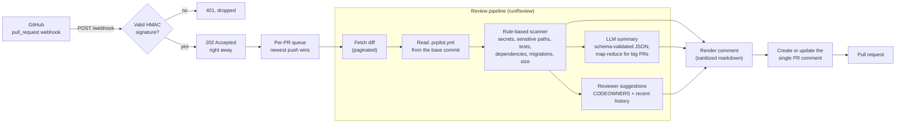
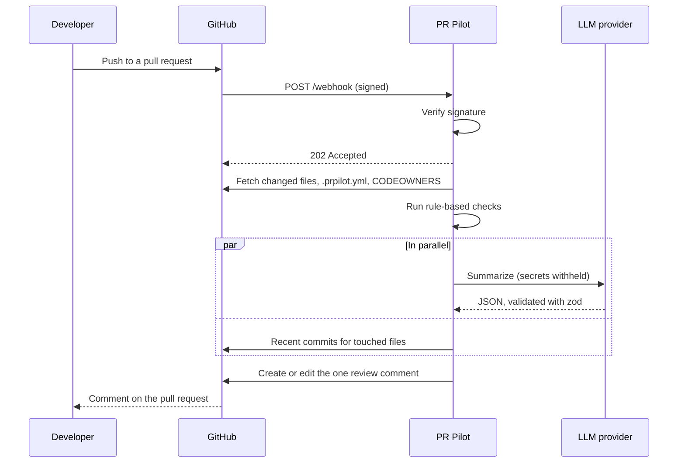

# PR Pilot

[](https://github.com/csmit191/pr-pilot/actions/workflows/ci.yml)


A GitHub App that reviews pull requests. On every push it posts **one comment** (edited in place, never
duplicated) with a summary of the change, the risky parts it found, and who should probably review it.

Deterministic rules run first, so a leaked key is never missed because a model was in a bad mood. An LLM
then reads the change and says what the rules can't. If the LLM is down, the rule-based findings and
reviewer suggestions still post.

## The problem

Reviewing a pull request starts with reconstructing context: what changed, what is dangerous, who knows
this code. That work is repetitive, and it is where careful reviewers lose time and tired reviewers skip
steps. PR Pilot does the first pass: it flags the things a reviewer must not miss (secrets, auth and
payment code, deleted tests, dependency and migration changes, oversized diffs), summarizes the rest,
and suggests reviewers from `CODEOWNERS` and recent history.

## Demo

<!-- Record a PR being opened and reviewed (ScreenToGif is a free recorder for Windows), save it as
     docs/demo.gif, then replace this note with the line below.

-->
_Demo GIF: coming soon._

## What it does

| | |
| --- | --- |
| **One comment per PR** | Created on `opened`, edited on every `synchronize`. A hidden marker plus the app's own identity find it again. If nothing changed, it is left alone. |
| **Rule-based checks** | Secrets (known key formats, hardcoded credentials, high-entropy strings), changes to auth/security/crypto/payment/billing code, deleted tests, dependency and lockfile changes, database migrations (destructive SQL is escalated), oversized diffs. Configurable per repo with `.prpilot.yml`. |
| **AI summary** | Summary, key changes, risks and suggested tests, returned as JSON and validated with a schema (one retry on invalid output). Large PRs are summarized file by file, then combined. |
| **Reviewer suggestions** | Up to 3 people, from `CODEOWNERS` first and recent committers to the touched files next. The PR author and bots are never suggested. |
| **Graceful degradation** | No LLM key, an LLM outage, or invalid model output never blocks the rest of the comment. |

## How it works





Design decisions worth knowing:

- **Rules before the LLM.** They are cheap, deterministic and never skip a leaked key. The LLM receives
  the rule findings as context and is told not to repeat them.
- **Respond fast, work later.** The webhook is answered with `202` immediately (GitHub gives deliveries
  10 seconds), and the review runs afterwards. Shutdown waits for reviews that are already running.
- **Newest push wins.** Reviews of the same PR run one at a time, and an older review that finishes after
  a newer push began does not post. This stops duplicate comments and stale overwrites.
- **Config comes from the base branch.** Otherwise a PR could add `ignore: ["src/auth/**"]` to hide its
  own risky changes. Changes to `.prpilot.yml` are themselves flagged.
- **A provider interface.** The LLM sits behind a small interface (`src/llm/provider.ts`) with one
  implementation (Anthropic, via plain `fetch`), so another vendor is one file.

## Quick start

You need Node.js 20.6 or newer and a GitHub account. An Anthropic API key is optional: without one you
get every rule-based check and reviewer suggestions, just no AI summary.

### 1. Install

```bash
git clone https://github.com/YOUR-USERNAME/pr-pilot.git
cd pr-pilot
npm install
cp .env.example .env
```

### 2. Register a GitHub App

GitHub → Settings → Developer settings → GitHub Apps → **New GitHub App**.

| Setting | Value |
| --- | --- |
| Webhook URL | Your smee.io URL while developing (below), your deployed `/webhook` URL later |
| Webhook secret | A long random string. It goes into `WEBHOOK_SECRET` |
| Repository permissions | **Pull requests: Read & write**, **Contents: Read-only**, Metadata: Read-only (automatic) |
| Subscribe to events | **Pull request** |

Create the app, note its **App ID**, then **Generate a private key** (a `.pem` download). Finally
**Install** the app on a repository you own. If you change permissions later, accept the new permissions
on the installation.

### 3. Configure

Edit `.env` (see [Configuration](#configuration)). The private key goes on one line with `\n` in place of
line breaks. On Windows PowerShell:

```powershell
(Get-Content .\private-key.pem -Raw) -replace "\r?\n", "\n"
```

### 4. Forward webhooks to your laptop

Go to [smee.io](https://smee.io), start a channel, and use its URL as the app's Webhook URL. Then:

```bash
npx smee-client --url <your-smee-url> --target http://localhost:3000/webhook
npm run dev
```

Open a pull request on the repository where the app is installed. A comment appears within seconds.
`npm run dev` prints one JSON log line per step (`Review comment posted` is the last).

## Configuration

### Environment variables

| Variable | Required | Purpose |
| --- | --- | --- |
| `WEBHOOK_SECRET` | yes | Must match the secret in the GitHub App. Used to verify every webhook |
| `GITHUB_APP_ID` | yes | The app's numeric ID |
| `GITHUB_PRIVATE_KEY` | yes | The app's private key, with `\n` for line breaks |
| `PORT` | no | Defaults to `3000` (hosts set it themselves) |
| `ANTHROPIC_API_KEY` | no | Enables the AI summary |
| `LLM_MODEL` | no | Defaults to `claude-haiku-5-5`, the cheapest tier |
| `GITHUB_TOKEN` | no | Only for the evaluation scripts (public-repo read access) |

Secrets are read only from the environment and are never logged or written to disk.

### Per-repository rules: `.prpilot.yml`

Put a `.prpilot.yml` in the root of a repository PR Pilot reviews. Everything is optional, and unknown
keys are rejected with a warning in the comment (the defaults are used) so a typo cannot silently turn a
check off. [`.prpilot.example.yml`](.prpilot.example.yml) documents every setting.

```yaml
ignore:
  - "vendor/**"
rules:
  secrets:
    allowPaths: ["test/fixtures/**"]
  largeDiff:
    maxChangedLines: 1200
  sensitivePaths:
    severity: critical
    patterns: ["**/auth/**", "**/billing/**"]
  deletedTests:
    enabled: false
```

| Rule | Flags | Default severity |
| --- | --- | --- |
| `secrets` | Known key formats (AWS, GitHub, Slack, Stripe, Google, Anthropic, OpenAI, private keys, JWTs) | critical |
| | Hardcoded credentials and high-entropy strings | high |
| `sensitivePaths` | auth, security, crypto, payment(s), billing, checkout | high |
| `deletedTests` | A deleted test file | medium |
| `dependencies` | Manifests such as `package.json` / lockfiles | medium / low |
| `migrations` | Migration files (destructive SQL, or a deleted migration, is high) | medium |
| `largeDiff` | More than 800 changed lines or 50 files (lockfiles don't count) | medium |

Also built in and not configurable: a change to `.prpilot.yml` itself, and a PR with more files than
GitHub will list (3,000).

### Reviewer suggestions

`score = 100 x (changed files you own in CODEOWNERS) + recent-history points`. History points per
changed file are the sum of `0.5^(age in days / 90)` over a person's commits to it in the last year,
capped at 2 per file, for the 8 most-changed files. Ownership always outranks history. Teams from
`CODEOWNERS` can be suggested; emails cannot. Handles are shown as code (`` `@alice` ``), not mentions,
so nobody is notified on every push.

## Deployment

The repository includes a multi-stage `Dockerfile` (production dependencies only, runs as a non-root
user), a Render Blueprint (`render.yaml`), and a step-by-step guide: **[docs/deploy.md](docs/deploy.md)**.

One thing to know before you start: Render's free tier sleeps after 15 idle minutes, and a webhook that
arrives while it sleeps is missed. The guide covers keeping it awake with a free uptime monitor and
redelivering anything that slips through.

## Evaluation

> **Status: results not published yet.** The evaluation harness is built and tested (see
> [`eval/README.md`](eval/README.md)). The figures belong here once it has been run on real, hand-labeled
> merged PRs; none are claimed until then.

<!-- EVAL-RESULTS:START
Run the evaluation, then paste eval/results/<run>/report.md here (only when it has no DRAFT banner):
precision and recall with 95% confidence intervals, rules-only vs rules+LLM recall, latency, cost per PR.
EVAL-RESULTS:END -->

How the evaluation works: merged PRs from public repositories are replayed through the same pipeline;
the author labels what a careful reviewer would flag *before* looking at the tool's output, then judges
each flag. Recall is the share of labeled risks caught (by rules alone, and by rules plus the LLM);
precision is the share of flags a reviewer would agree with. Every rate is reported with a Wilson 95%
confidence interval, and the report refuses to look final while any verdict is missing.

## Security design

- **Webhook authenticity.** Every delivery's HMAC-SHA256 signature is verified over the raw body with a
  constant-time comparison, before anything is parsed.
- **Least privilege.** Only the three repository permissions above. No secrets in the repository,
  the image, or the logs.
- **Untrusted text.** PR titles, descriptions, file names, diffs, and even LLM output are treated as
  hostile: the prompt marks them as data, forged closing tags are neutralized, and everything placed in
  the comment is escaped (HTML, `@mentions`, `#123` cross-references, links, images, code fences) so a
  PR cannot ping people, spam other issues, or forge the marker.
- **Secrets stay local.** Any file where the scanner found a secret is withheld from the LLM entirely, not
  just the flagged line.
- **Only our own comment is ever edited**: it must carry the marker *and* have been posted by this GitHub
  App.
- **Config from the base branch**, so a PR cannot weaken the rules that review it.

## Limitations

- **Free hosting sleeps.** See the deployment guide. A missed webhook has to be redelivered by hand.
- **Only `opened` and `synchronize`.** A PR that is already open when the app is installed is reviewed on
  its next push. `reopened` and draft-to-ready are not handled.
- **One server process.** The per-PR queue lives in memory. Running several instances would need a shared
  lock.
- **No retry with backoff** for LLM rate limits or outages: the summary is marked unavailable and the
  rule-based sections still post.
- **Heuristic detection.** Pattern and entropy matching has false positives and false negatives, and
  nothing scans git history. A secret sitting on an unchanged context line could still be sent to the
  LLM provider.
- **Prompt injection is mitigated, not eliminated.** A hostile diff can still bend the wording of a
  summary, though it cannot make the comment ping anyone or hide a rule finding.
- **GitHub's limits apply.** At most 3,000 files per PR, and very large files come without a diff (they
  are listed as "not scanned" instead).
- **Suggestions are from history, not availability.** It does not check that a suggested reviewer has
  access, is active, or is on leave.
- **A comment, not a gate.** It does not block merges or leave inline comments.
- **Tests use fakes** for GitHub and the LLM. End-to-end behavior is verified by hand on a real repository.
- **The evaluation is small and single-rater** (see above).

## Future work

- Retry with backoff for rate limits and overloads; cache per-file summaries between pushes to cut cost.
- A shared queue (for example Redis) so multiple instances can run, and so a restart cannot lose a review.
- Handle `reopened` and `ready_for_review`, skip or lighten drafts, and review PRs that are already open
  when the app is installed.
- Inline review comments anchored to the flagged lines, and a GitHub Check Run for pass/fail gating.
- Request the suggested reviewers through the API instead of only listing them.
- A `/prpilot` command to re-run on demand; org-wide default configuration.
- More LLM providers behind the existing interface, and a larger evaluation with a second rater.

## Development

```bash
npm run dev          # run with auto-reload (reads .env)
npm run typecheck    # tsc --noEmit
npm run lint         # ESLint
npm test             # Vitest
npm run build        # compile to dist/
npm run format       # Prettier
```

CI (`.github/workflows/ci.yml`) typechecks, lints, tests (Node 20 and 22) and builds, then builds the
Docker image, boots it, checks `/healthz`, rejects an unsigned webhook, and confirms a clean `SIGTERM`
shutdown. Dependabot proposes weekly updates.

```text
src/
  index.ts              wiring, config, graceful shutdown
  server.ts             HTTP server: signature check, immediate 202, in-flight tracking
  handlers/pullRequest.ts   webhook -> per-PR queue -> review -> comment
  review/pipeline.ts    the review itself (no side effects; reused by the evaluation)
  diff/                 changed-file fetching (paginated) and parsing
  risk/                 rule-based scanner, rules, .prpilot.yml parsing
  llm/                  provider interface, Anthropic client, prompts, summarizer
  reviewers/            CODEOWNERS parsing, commit history, scoring
  comment/              rendering, sanitizing, find-and-update the comment
  eval/                 evaluation harness (collect, run, report)
  util/                 concurrency, latest-wins queue, in-flight tracker
test/                   unit and integration tests
eval/                   evaluation guide and data
docs/                   deployment guide
```
